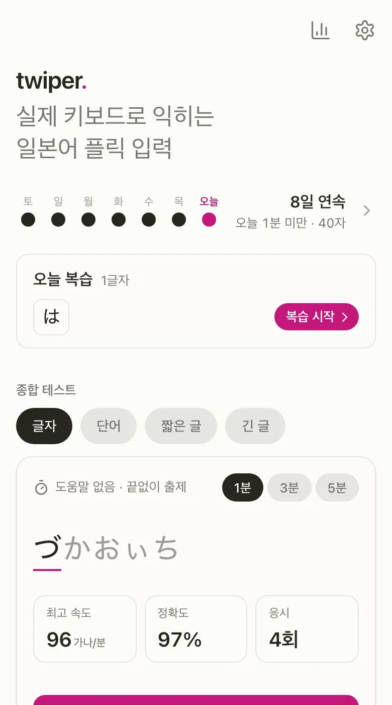
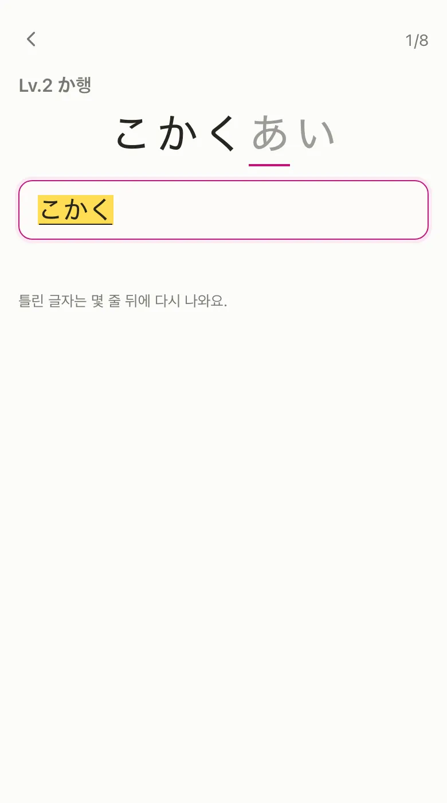
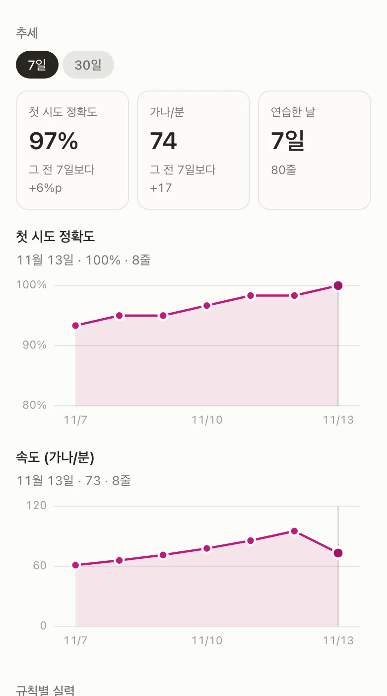
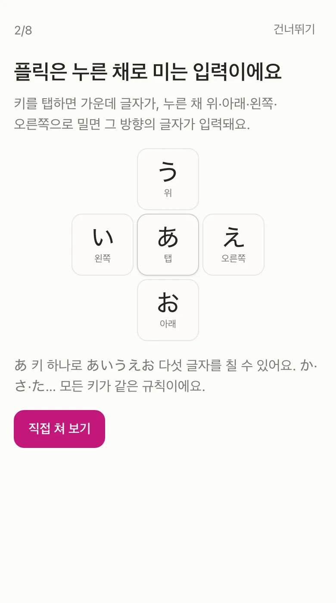

<h1 align="center">twiper</h1>

<p align="center">
  <strong>실제 키보드로 익히는 일본어 플릭 입력</strong><br />
  iPhone 일본어 가나 키보드(12키)로 플릭 입력을 연습하는 무료 웹앱
</p>

<p align="center">
  <a href="https://twiper-kana.vercel.app"><strong>twiper-kana.vercel.app 에서 바로 시작하기 →</strong></a>
</p>

<p align="center">
  
  
  
  
</p>

> **日本語** — iPhone の日本語かなキーボード（12キー）で、フリック入力を練習する無料のウェブアプリです。画面の中の偽キーボードではなく、いつものキーボードで入力した文字を採点し、苦手な文字を見つけて繰り返し練習できます。登録不要・オフライン対応。
>
> **English** — A free web app for learning Japanese 12-key kana flick input on your real iPhone keyboard. Instead of an on-screen fake keyboard, it grades what you type with the system Japanese Kana keyboard, finds the characters you miss, and drills them. No sign-up, works offline.

## 왜 twiper인가

로마자 입력에 익숙하면, 플릭으로 바꿔 보려 해도 글자 위치와 방향이 바로 떠오르지 않습니다. 몇 번 해 보다 결국 로마자로 돌아가게 됩니다. twiper는 그 전환을 끝까지 이어 가도록 짧고 반복적인 연습을 만들어 줍니다.

- **화면 속 가짜 키보드가 없습니다.** 지금 쓰는 iPhone의 일본어 가나 키보드로 치고, 입력된 글자를 채점합니다. 연습한 손놀림이 그대로 실제 입력이 됩니다.
- **틀린 글자는 고쳐야 넘어갑니다.** 기초 단계는 조합 중인 글자가 맞는 순간 표시하고, 단어·문장은 確定까지 해야 정답입니다.
- **약한 글자를 찾아 다시 시킵니다.** 자주 틀리거나 오래 걸리는 글자를 모아 연습하고, 며칠 간격으로 복습하게 합니다.

## 할 수 있는 것

|                               |                                                                                                                                                                                                          |
| ----------------------------- | -------------------------------------------------------------------------------------------------------------------------------------------------------------------------------------------------------- |
| **튜토리얼**                  | 가나 키보드 준비, 플릭 방향, 12키 배치를 그림과 직접 쳐 보기로 익힙니다. 홈에서 언제든 다시 볼 수 있습니다                                                                                               |
| **단계별 익히기**             | Lv.1–24. 기초(あ행~わ행, 50음 랜덤) → 조합(탁음·반탁음·작은 글자·요음·촉음·장음) → 가타카나 → 기호 → 문장·채팅 → 영문·숫자 섞어 치기. 레벨마다 키 도해를 보여 주고, 막히면 그 글자 치는 법을 알려 줍니다 |
| **약점 연습**                 | 최근에 자주 틀리거나 오래 걸린 글자로 8줄을 만듭니다                                                                                                                                                     |
| **오늘 복습**                 | 며칠 전에 틀린 글자를 홈에서 다시 칩니다. 맞히면 다음 복습이 3일·7일·21일 뒤로 늘어납니다                                                                                                                |
| **종합 테스트**               | 글자·단어·짧은 글·긴 글 네 종목, 1·3·5분. 도움말 없이 끝없이 나옵니다                                                                                                                                    |
| **내 실력**                   | 규칙별 첫 시도 정확도와 글자당 시간, 자주 틀리는 글자, 오래 걸리는 글자, 7일·30일 추세                                                                                                                   |
| **달력**                      | 연습한 날과 연속 일수                                                                                                                                                                                    |
| **키보드 설명서 · 글자 찾기** | 지구본·ABC·^^ 같은 키의 쓰임과, 어떻게 치는지 모르는 글자의 입력 방법                                                                                                                                    |
| **속도 단위**                 | 가나/분(기본) · CPM · WPM. CPM·WPM은 헤본식 로마자 기준이며 계산법을 화면에 밝힙니다                                                                                                                     |
| **화면 언어**                 | 한국어 · 日本語 · English. 기기 언어를 따르고, 설정에서 바꿀 수 있습니다                                                                                                                                 |
| **오프라인 · 설치**           | 한 번 열면 인터넷 없이 연습할 수 있고, 홈 화면에 추가하면 앱처럼 열립니다                                                                                                                                |
| **기록 백업**                 | 진도와 연습 기록을 파일 하나로 저장하고, 다른 브라우저나 기기에서 가져와 합칩니다                                                                                                                        |

## iPhone에서 시작하기

1. **가나 키보드 추가** — 설정 › 일반 › 키보드 › 키보드 › 새로운 키보드 추가 › 일본어로 들어가, 로마자가 아닌 **가나** 키보드를 추가합니다.
2. **(권장) 「フリックのみ」 켜기** — 설정 › 일반 › 키보드의 「フリックのみ」를 켜면, 같은 키를 빠르게 두 번 탭해도 글자가 바뀌지 않아 플릭 연습에 좋습니다.
3. **홈 화면에 추가** — Safari에서 [twiper-kana.vercel.app](https://twiper-kana.vercel.app)을 열고 공유 › 홈 화면에 추가를 누릅니다. 전체 화면으로 열리고, iOS가 오래 열지 않은 사이트의 저장소를 지울 때도 기록이 남습니다.
4. **튜토리얼부터** — 처음이라면 튜토리얼을 보고 Lv.1부터 차례로 익힙니다. 입력할 때는 키보드의 지구본 키로 あ·か·さ 키가 있는 12키 키보드로 바꿉니다.

> 지금은 **iPhone 기본 일본어 가나 키보드**를 기준으로 만들었습니다. 다른 키보드(예: Gboard)로도 입력과 채점은 되지만, 키 도해와 안내가 실제 배치와 다를 수 있습니다.

## 개인정보

- **계정이 없습니다.** 이름·이메일을 받지 않습니다.
- **기록은 이 기기의 브라우저에만 남습니다** (IndexedDB·localStorage). 연습 기록을 서버로 보내지 않습니다.
- 분석·광고 코드를 넣지 않았습니다. 앱 파일을 내려받을 때의 일반적인 접속 기록은 호스팅(Vercel)에 남을 수 있습니다.
- 다른 기기로 옮기려면 설정 › 기록 백업에서 파일로 저장해 가져오세요. 계정 없는 기기 간 동기화는 [설계 문서](docs/superpowers/specs/2026-11-13-cloud-sync-design.md)만 있고 아직 만들지 않았습니다.

---

## 개발

### 구조

| 경로               | 역할                                                                                                                                                     |
| ------------------ | -------------------------------------------------------------------------------------------------------------------------------------------------------- |
| `packages/core`    | 플랫폼 독립 로직: 가나 표·정규화·토크나이저, 입력 세션(조합·확정 판정), 채점·오류 분류, 출제, 통계, 로마자 변환. 순수 TypeScript이며 DOM을 쓰지 않습니다 |
| `packages/content` | 레벨·단어·문장·튜토리얼·iPhone 가나 키보드 가이드 데이터                                                                                                 |
| `apps/web`         | Vite + React 웹앱 (PWA). 저장은 Dexie(IndexedDB)                                                                                                         |

`core`와 `content`는 화면 코드와 분리되어 있어, 나중에 React Native 앱에서 그대로 가져다 쓸 수 있습니다. 경계는 ESLint 규칙과 DOM 없는 tsconfig로 강제합니다.

**기술:** TypeScript · React 19 · Vite · React Router · i18next · Dexie · vite-plugin-pwa (Workbox) · Vitest · Playwright · pnpm workspace

### 명령

Node 22.12 이상과 pnpm 10이 필요합니다.

```sh
pnpm install
pnpm dev         # 개발 서버 (이 컴퓨터에서만)
pnpm dev:lan     # 같은 Wi-Fi의 스마트폰에서 접속 + 실기 trace 수집
pnpm test        # 단위 테스트 (core · content · web)
pnpm typecheck
pnpm lint
pnpm build
pnpm e2e         # 화면 흐름 테스트 (빌드 후 iPhone 크기 Chromium, 일본어 입력은 IME 명령으로 흉내)
```

CI(GitHub Actions)는 타입 검사·린트·단위 테스트·빌드·화면 흐름 테스트를 모두 돌립니다. `main`에 병합하면 Vercel로 배포됩니다.

### 설치형 앱(PWA)

- 빌드하면 `manifest.webmanifest`와 서비스 워커(`sw.js`)가 생기고, 앱 화면과 콘텐츠를 모두 미리 받아 둡니다. 서비스 워커는 빌드에서만 켭니다.
- 새 버전은 홈·설정에 「새 버전이 있어요」로만 알리고, 사용자가 「업데이트」를 눌렀을 때 적용합니다. 연습·튜토리얼 중에는 알리지 않습니다.
- 이 컴퓨터에서 확인: `pnpm build && pnpm --filter @twiper/web preview` 후 `http://localhost:4173`.
- 서비스 워커는 HTTPS(또는 localhost)에서만 동작합니다. LAN 주소(`http://192.168…`)로 연 홈 화면 앱은 오프라인으로 동작하지 않습니다.

### 개발 도구 (`/lab`)

- **`/lab/ime`** — 실제 키보드의 입력 이벤트를 기록하는 IME 진단 화면. `pnpm dev:lan`을 실행하고 터미널에 표시된 `IME lab:` 주소(`…/lab/ime#k=…`)를 같은 Wi-Fi의 스마트폰에서 엽니다. 「서버로 보내기」를 누르면 trace가 `packages/core/test/fixtures/traces/incoming/`에 저장됩니다.
- **`/lab/guide-check`** — 안내된 동작(예: `[や] 키 ← 왼쪽으로 플릭`)을 실제 키보드로 하고, 나온 글자를 키보드 가이드 데이터와 대조합니다.
- 그 밖의 `/lab/*`는 새 화면을 넣기 전에 확인하는 시안입니다.

`pnpm dev:lan`은 개발 서버를 같은 네트워크에 열고 trace 저장 엔드포인트(`/__trace`)를 켭니다. 이 엔드포인트는 저장소 폴더에 파일을 쓰므로, 서버를 띄울 때마다 새로 만드는 키(주소의 `#k=…`)를 가진 요청만 받고 요청 크기와 저장 파일 수를 제한합니다. 신뢰할 수 있는 네트워크에서만 쓰세요.

### 문서

- [구현 계획](docs/superpowers/specs/2026-10-07-twiper-design.md) — 제품 정의, 입력·채점 구조, 커리큘럼, 통계, 저장, 로드맵
- [결정 0001: 문제 전환은 確定 후에 한다](docs/decisions/0001-ime-input.md) — iPhone 실기 trace로 정한 입력 처리 방식
- [기기 간 동기화 설계](docs/superpowers/specs/2026-11-13-cloud-sync-design.md) — 계정 없는 동기화 코드 + 종단 간 암호화 (구현 전)
